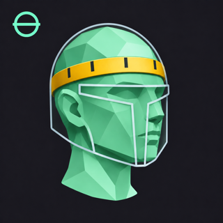

# Head Room for OrcaSlicer

Create a personal reference head and try on cosplay helmets in OrcaSlicer. Head Room 0.3.0 keeps a library of measured heads and imported head scans. Each save adds a separate head, even when two have the same name. An existing head from 0.1.0 or 0.2.0 appears in the portrait library after the update.

## Install

- Open the [Head Room listing](https://cloud.orcaslicer.com/app/plugins/plugin-hub/47a2a727-e5bd-4a1a-a51e-2cc40e8730f9) and choose **Subscribe**. In OrcaSlicer, sign in with the same account, open **File → Plugins**, click **Refresh**, and check **Activate** beside Head Room.
- To install a local build in OrcaSlicer 2.5.0, open **File → Plugins**, click the arrow to the left of **Install plugin**, choose **Install local plugin**, then click the newly labeled button. Select `dist/cloud/head_room_any.py` and activate it. Reuse that filename when updating to keep the same local plugin identity.
- For a standalone browser preview, open `dist/HeadRoom.html`. The browser keeps its own saved heads and downloads the fitted helmet.

Local and Cloud installations have separate head libraries. Update the installation you already use; only one Head Room page can be active at a time. Switching between the two can make saved heads appear to disappear.

## Try on a helmet

1. Choose **Make my head** for four guided measurements, or **Use my own STL** for a head scan in millimetres (up to 32 MiB). Choose **Add to saved heads**. Next time, click its portrait under **Your heads**.
2. Choose **Choose helmet STL**. Use a single assembled shell in millimetres, up to 96 MiB. The shell starts centered on the head. Drag **Move** arrows or **Rotate** rings to position the helmet on its local axes. Drag the background to orbit, scroll to zoom, and Shift-drag or middle-drag to pan. **Reset view** resets the camera. **Precise alignment** offers translations and quarter turns. Line up the visor and chin before sizing.
3. Compare the head and helmet in **3D**, **Side cut** and **Front cut**. The section lines show the actual head (mint) and shell (gold) triangles cut by the middle plane. The 3D viewport draws every helmet triangle. Use the opacity slider to reveal the head; it starts at 50%. Change the helmet scale uniformly or by axis. The reference head and camera keep their size. To estimate a starting scale, enter padding per side and click **Estimate helmet scale**. The estimate samples the first inner wall in both horizontal directions along each axis through the helmet center, and the inner crown above it. Open or ambiguous samples leave the scale unchanged. Check the visor, nose, jaw and entry opening yourself.
4. Choose **Open fitted helmet in OrcaSlicer**. Only the fitted helmet goes to Orca, with all the original triangles. Orca may ask for permission to open it. On macOS it uses the normal open-document event. On Windows and Linux it launches a discoverable OrcaSlicer executable with the fitted STL, which may open another window. If the application cannot be opened, the page gives the path to the fitted file. Use **Head details** to export the mannequin separately if needed.

The opening screen includes [Uncle Jessy’s printable cosplay calipers](https://www.printables.com/model/14099-cosplay-calipers/files). The face is an approximate mannequin. The plugin currently uses brow circumference, skull width, brow-to-back depth and chin-to-crown height. These four measurements estimate overall size. They do not locate the wearer’s pupils or nose tip, or tell you if their ears and jaw can pass through a one-piece helmet opening. Align the visor at eye level with your intended padding, inspect the nose in the side cut, and test the narrowest entry with a thin printed cross-section before committing to a full print. An ear-to-ear arc over the crown can refine dome shape; neck and shoulders matter most for a deep rim or rigid collar. See a [cosplay helmet maker’s sizing guide](https://www.border3dllc.com/pages/cosplay-helmet-sizing-guide).

## Build

Run `python3 build.py` to regenerate the preview and plugin. Run `node tests/geometry.cjs` and `node tests/fit.cjs` for the geometry and STL checks. Run `python3 tests/profiles.py` to check migration and preservation of same-name heads. You may pass a local high-detail helmet STL to `tests/fit.cjs` to verify that export preserves every triangle. On macOS with Chrome, run `node tests/viewport.cjs /path/to/helmet.stl` to exercise actual mouse gestures, stable framing, opacity and the full triangle count in an isolated profile. On other platforms set `CHROME_BIN` to the browser executable. The Orca Cloud upload and icon are in `dist/cloud/`.

Head Room and its procedural headform are available under the MIT license. The offline 3D viewport bundles Three.js r128, OrbitControls and TransformControls ([MIT notice](src/vendor/LICENSE)). A device without WebGL can still use both cuts and numeric alignment. Wearer profiles stay local. Head Room has no runtime downloads and includes no third-party helmet files.
